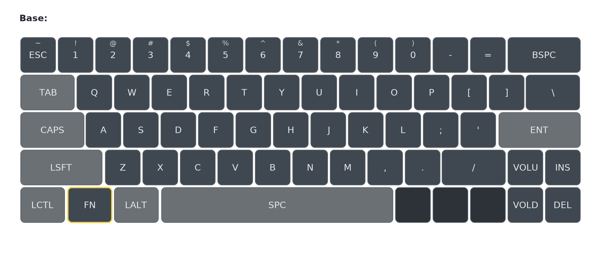
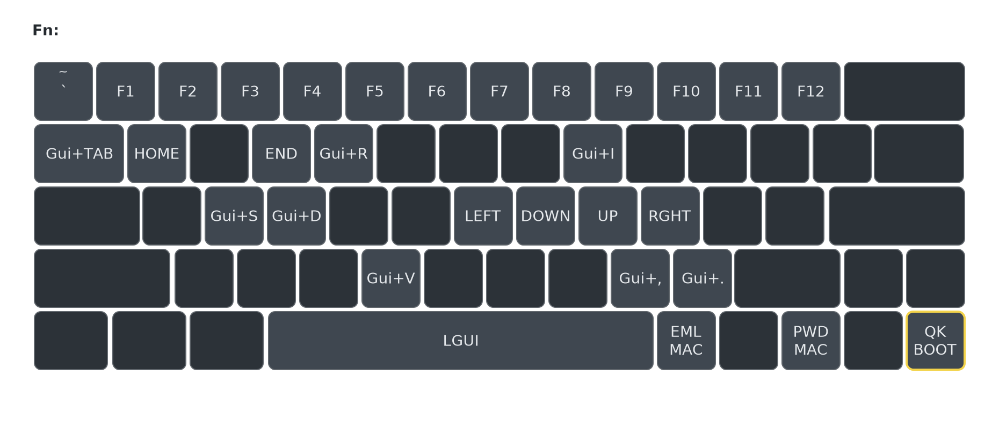

# DZ60RGB V2.1

## Layer

Base:





## Cấu hình

| Linh kiện  | Mô tả                                                                                 |
| :--------- | :------------------------------------------------------------------------------------ |
| **Kit**    | [Tofu60 Redux](https://kbdfans.com/products/tofu60-redux-kit-1)                       |
| **PCB**    | [DZ60RGB V2.1](https://kbdfans.com/products/dz60rgb-hot-swap-custom-keyboard-pcb)     |
| **Plate**  | [Tofu60 Plate](https://kbdfans.com/products/tofu60-redux-plate)                       |
| **Stab**   | [Cherry Screw-in](https://kbdfans.com/products/cherry-pcb-mount-screw-in-stabilizers) |
| **Keycap** | [SA Aifei Yellow Screen](https://kicap.vn/bo-keycap-sa-aifei-black-gold)              |
| **Switch** | [HMX Pink Peach](https://kicap.vn/switch-hmx-pink-peach-linear-silent)                |

## Build

Cài QMK một lần: Windows dùng [QMK MSYS](https://msys.qmk.fm/), macOS/Linux chạy `curl -fsSL https://install.qmk.fm | sh`.

```sh
qmk setup
git clone https://github.com/ovftank/qmk-dz60rgb-v2.1.git
qmk config user.overlay_dir="$(realpath qmk-dz60rgb-v2.1)"
qmk compile -kb dztech/dz60rgb/v2_1 -km ovftank
```

firmware output `qmk_firmware/dztech_dz60rgb_v2_1_ovftank.bin`.

## Flash

Bootloader là LUFA mass storage: vào bootloader thì board hiện thành ổ USB tên `KBDFANS`, nhận file `.bin`. `qmk flash` ko hỗ trợ loại này nên phải copy tay.

1. Vào bootloader: giữ `Esc` lúc cắm cáp, hoặc bấm `Fn` + `Del`. Ko thấy ổ KBDFANS thì tháo case, bấm nút RESET mặt sau PCB.
2. Trong ổ: xoá `FLASH.BIN` cũ (để nguyên `EEPROM.BIN`), copy file `.bin` vào rồi đổi tên thành `FLASH.BIN`.
3. Eject ổ đúng cách, rồi rút cáp, đợi vài giây, cắm lại.

Manual: [KBDfans USB Drive Flash Manual](https://docs.google.com/document/d/111qx6Qec4JqtIhWaZlMND-VuRnFtn9a-gJaHN8fsL7M/edit?usp=sharing).

## Dev

gen `compile_commands.json`

```sh
python3 tools/clangd-db.py
```
